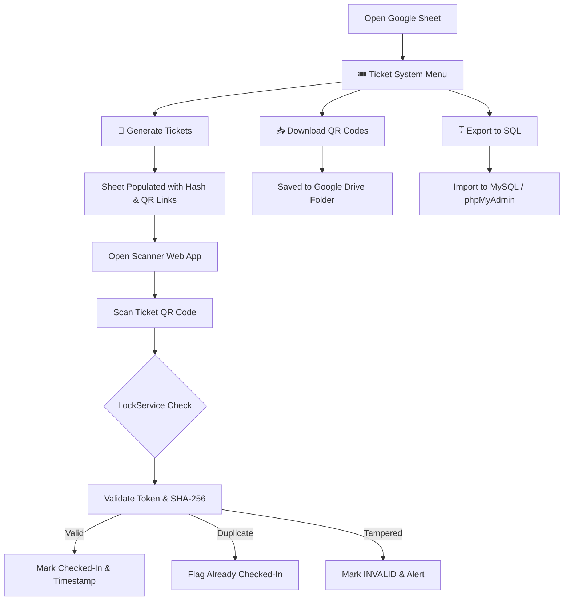

# 🎟️ Secure Event Ticket Generation & Management System

A robust, enterprise-grade Google Apps Script application designed to generate cryptographically signed QR-code tickets, conduct high-speed attendee check-ins, protect against race conditions and ticket counterfeiting, and export ticket databases directly to SQL for MySQL / phpMyAdmin hosting.

---

## 🚀 Key Features

* **🔐 Cryptographic Security & Anti-Forgery:**
  * Uses high-entropy random tokens (Base32 unambiguous character set, excluding `0`, `1`, `I`, `O`).
  * Computes salted SHA-256 validation signatures (`ticketId` + `token` + `SECRET_KEY` + `EVENT_CODE`).
  * Verifies both token equality and cryptographic signature on every scan to detect altered or fabricated tickets.

* **⚡ Concurrency-Safe Check-In Engine:**
  * Uses Google Apps Script `LockService` to prevent double check-in race conditions when multiple door attendants scan tickets simultaneously.
  * Atomically commits status updates and check-in timestamps in single batch operations.
  * Trims and normalizes hardware barcode scanner inputs (including trailing newlines and carriage returns).

* **📱 Mobile & Desktop QR Scanner Web App (`Index.html`):**
  * Live camera QR code scanning powered by `html5-qrcode`.
  * Dedicated Barcode / Manual scanner input with autofocus for handheld USB/Bluetooth hardware scanners.
  * Real-time mode switch: **Check-In Mode** (marks ticket) vs. **Verify Only Mode** (read-only inspection).
  * Web Audio API synthesized sound cues (success chime, warning chime, error buzz).
  * Real-time statistics counters (Total, Checked-In, Remaining, Invalid).

* **🌐 Built-in REST API:**
  * Deployable as a Google Apps Script Web App that serves both the UI and JSON endpoints:
    * `GET /exec?action=checkin&code=TICKET-D-0001-A2B3C4D5`
    * `GET /exec?action=verify&code=TICKET-D-0001-A2B3C4D5`
    * `GET /exec?action=stats`

* **📥 High-Performance Batch QR Downloader:**
  * Downloads QR code images to Google Drive using parallel requests (`UrlFetchApp.fetchAll`) in batches of 20.
  * Creates timestamped, categorized Drive folders (`{EVENT}_Tickets_{TYPE}_{TIMESTAMP}`).
  * State tracking via Script Properties allows resuming downloads across execution limits.

* **🗄️ Production SQL Database Exporter:**
  * Exports tickets into standard `.sql` dumps chunked into 250-row multi-row `INSERT` statements to avoid MySQL `max_allowed_packet` errors.
  * Clean relational schema with indexing on `security_token`, `ticket_type`, and `status`.
  * Proper `NULL` handling for unassigned timestamps in MySQL strict mode (`STRICT_TRANS_TABLES`).
  * In-sheet download dialog and one-click clipboard copy.

* **📋 Unified Google Sheets Menu:**
  * Automatic `🎟️ Ticket System` menu inside Google Sheets for 1-click execution without opening the code editor.

---

## ⚙️ Configuration Variables

Configure event parameters at the top of `Code.gs` inside the `CONFIG` object:

```javascript
var CONFIG = {
  TICKET_TYPE: "D",                            // Category identifier (e.g., A, B, C, D, VIP, GA)
  TICKET_QUANTITY: 2850,                       // Number of tickets to generate
  SPREADSHEET_ID: "",                          // Leave empty ("") when bound to a sheet (auto-detected)
  EVENT_CODE: "Geethanjalee360",               // Unique event identifier
  SECRET_KEY: "CHANGE_THIS_TO_YOUR_SECRET_KEY", // Secret salt for SHA-256 signature
  TOKEN_LENGTH: 8,                             // Length of random security token
  QR_SIZE: 250,                                // QR image size in pixels
  QR_BATCH_SIZE: 100                           // Batch size for Drive downloads
};
```

> **Security Tip:** For production deployments, you can set `SECRET_KEY` in **Project Settings > Script Properties** with the property key `SECRET_KEY`. This avoids committing raw secrets to source control.

---

## 📦 Core Workflow & Usage



### 1. Generating Tickets (`generateQRCodes`)
* Select **🎟️ Ticket System > 🎫 Generate Tickets** from the sheet menu.
* Sets up headers: `Ticket ID`, `Ticket Type`, `Security Token`, `Validation Hash`, `QR Code Link`, `Status`, `Timestamp`.
* Automatically scans existing rows to detect the current sequence number for the ticket type and increments cleanly.
* Generates QuickChart QR codes embedding the encrypted ticket code.
* Applies conditional formatting colors (Yellow = Not Checked-In, Green = Checked-In, Red = INVALID).

### 2. Live Scanner Web App (`Index.html` / `doGet`)
1. In Apps Script editor, click **Deploy > New deployment**.
2. Select type **Web app**.
3. Set **Execute as:** `Me` and **Who has access:** `Anyone with Google account` (or `Anyone` for event staff).
4. Open the generated Web App URL on a smartphone or tablet:
   * **Camera Scan:** Points device camera at attendee ticket QR codes.
   * **Barcode / Manual Scan:** Supports USB/Bluetooth 1D/2D handheld barcode guns.
   * **Sound Feedback:** Instant audio chimes confirm scan status without looking at the screen.

### 3. Downloading QR Codes to Drive (`downloadAllQRCodesAutomatically`)
* Select **🎟️ Ticket System > 📥 Download QR Codes (Batch)**.
* Creates a folder in Google Drive and downloads QR images named `{TicketID}.png`.
* Run repeatedly until all batches report 100% completion.

### 4. Database SQL Export (`exportToSQLFile`)
* Select **🎟️ Ticket System > 🗄️ Export to SQL File**.
* Click **⬇️ Download tickets_import.sql**.
* In **cPanel > phpMyAdmin**, select your database, click **Import**, and upload the file.

---

## 🧪 Local Testing

A comprehensive zero-dependency test suite is included in `test/test_suite.js` using Node.js's native test runner (`node --test`).

Run the test suite:
```bash
npm test
```

### Tested Scenarios:
- [x] Base32 secure token generation (length, uniformity, absence of ambiguous characters `0, 1, I, O`).
- [x] Deterministic SHA-256 validation hash computation and tamper sensitivity.
- [x] Sheet coordinate bounds validation on default 1000-row sheets.
- [x] Ticket type sequence detection across arbitrary prefixes (`Type D`, `Type A`, `VIP`).
- [x] Successful check-in and atomic status/timestamp updates.
- [x] Duplicate check-in prevention.
- [x] Forged token and tampered signature detection.
- [x] Trimming of hardware scanner inputs with carriage returns and whitespace.
- [x] Read-only verification (`verifyTicket`) without mutating sheet rows.
- [x] Aggregated event statistics breakdown.
- [x] Web App (`doGet`) HTML output and JSON REST API responses.
- [x] SQL export formatting, escaping, strict-mode `NULL` handling, and batched chunking.

---

## 🛠️ Installation & Setup in Google Sheets

1. Open your Google Sheet.
2. Navigate to **Extensions > Apps Script**.
3. Copy the contents of `Code.gs` into `Code.gs` in the editor.
4. Add a new script file named `sqlSheet.gs` and paste the contents of `sqlSheet.gs`.
5. Add a new HTML file named `Index.html` and paste the contents of `Index.html`.
6. Click **Save** (💾).
7. Reload your Google Sheet. The **🎟️ Ticket System** menu will appear in the top toolbar!
